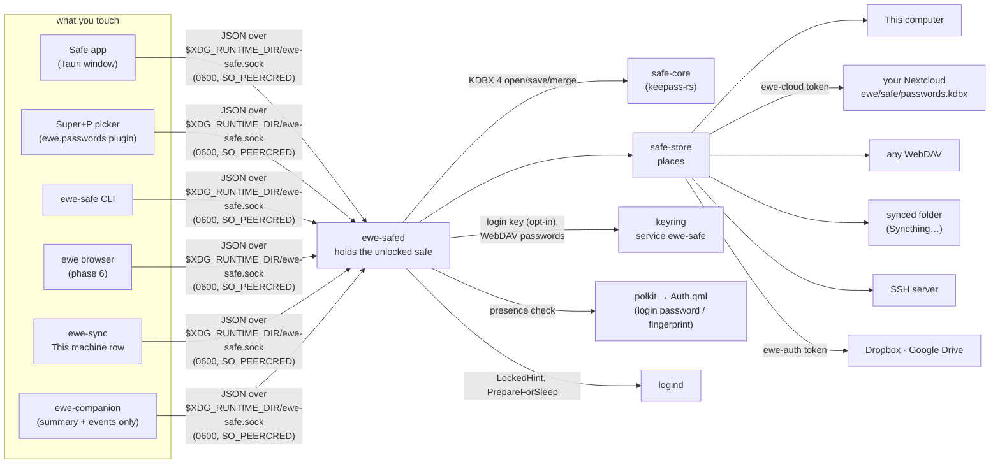
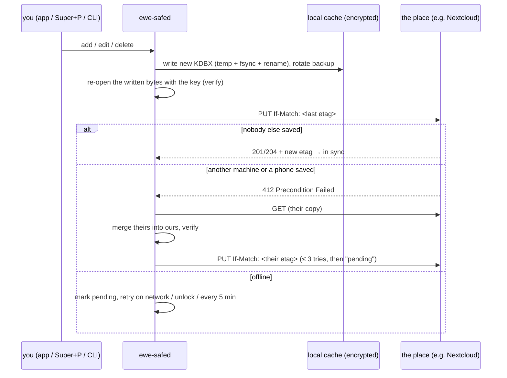

# RFC-008 — Safe, ewe's password manager

*Status: **accepted** 2026-10-14 (the owner: "start building new app
according to your guide"; every default in the plan's open questions taken).
Repo: `prj786/ewe-safe` (local, phase 0). The build plan — phases, gates,
testing, risks, parked ideas — is `ewe-safe/PLAN.md`; this RFC is its
decision part (§2–§14); section numbers and § references are the plan's.*

## The idea

Safe (`ewe-safe`) is ewe's own password manager. It's much simpler than
1Password: one safe, one master password, two kinds of item (logins and
notes), and a search box. The safe is one encrypted file in the standard
KeePass format (KDBX 4), kept where the user chooses: this computer, their
own Nextcloud (the default), any WebDAV server, a synced folder, an SSH
server, or Dropbox and Google Drive. Every save syncs straight away, and two
machines merge instead of making conflicted copies. `Super+P` fills logins
into any app. KeePassXC and the KDBX phone apps open the same file, so
nobody is locked in.

## 2. The big decisions

These are the decisions the RFC asks the owner to accept. Each one says why.

### S1. The safe is a KeePass file (KDBX 4), not a format of our own

- **No lock-in.** KeePassXC (Arch `extra`), KeePassDX (Android), and Strongbox
  and KeePassium (iOS) open the same file. That gives a phone story on day
  one without building an app.
- **The crypto is standard and has been reviewed for years:** Argon2id key
  derivation, AES-256 encryption, and an HMAC on every block. We write no
  crypto of our own.
- **It merges.** Every entry has a UUID and modification times, and the file
  records deletions (`DeletedObjects`). That is what makes "merge, never
  conflicted copy" possible (S5).
- *Cost:* we have to preserve everything other apps put in the file
  (attachments, history, custom icons, custom data, passkeys) even if we don't
  show it. Phase 0 is a go/no-go test of exactly that.

### S2. One file, many places, self-hosted first

The safe is one file. A **place** is where that file lives. All places are
equally safe, because the file is encrypted before it leaves the machine: the
place sees only an opaque blob, its size, and when it changed. What differs
between places is who you depend on. That's why the self-hosted places come
first.

Order of support: **This computer** · **Your ewe account (Nextcloud)** →
**any WebDAV server** · **a synced folder (Syncthing, …)** · **SSH server** →
**Dropbox** · **Google Drive**.

### S3. No new login: the ewe account and `ewe-auth` do the signing in

You asked for "ewe-auth working as part of it". Today the account side is two
tools, and Safe uses both without adding a third login:

- **Nextcloud** (the ewe account, RFC-005): Safe asks `ewe-cloud token` for the
  app password that ewe-sync already stored. There's no second sign-in, and the
  password never leaves the keyring except over stdin.
- **Google Drive** and **Dropbox**: Safe asks `ewe-auth token`. `ewe-auth` stays
  the only thing that touches a refresh token (house rule 7). It gains a
  `drive.file` scope set for Google and a second provider, Dropbox (phase 5).
- **Generic WebDAV**: the server password goes in the keyring (service
  `ewe-safe`). Only the URL and username go in `ewe.conf`, the same as Mail's
  IMAP account today.

If you're not signed in when you pick "Your ewe account", Safe sends you to
ewe-sync → Account. Signing in happens in one place.

### S4. A small daemon holds the unlocked safe; the shell never sees the master password

- `ewe-safed` runs as a **socket-activated user service**. It starts on first
  use and keeps the safe unlocked across shell restarts (rule 11), so `Super+P`
  works with the app window closed.
- **You type the master password only into the Safe window (or a terminal).
  You never type it into the shell.** Plugins run unsandboxed in the shell's
  QML engine (Plugins Unsandboxed), so a master password typed there could
  be read by any plugin.
- The socket uses the same pattern as `ewe-companiond`: `0600` in
  `$XDG_RUNTIME_DIR`, and both ends check `SO_PEERCRED` (same uid, or no
  answer).

### S5. Every save is a sync; two machines merge, they don't conflict

- Saving writes locally first and then uploads at once, with the place's own
  conflict guard (WebDAV `If-Match`, the same guard `ewe-conf push` uses).
- If another machine (or a phone) saved in between, the daemon downloads that
  copy, **merges** it into this one, checks the result, and uploads that. It
  never writes `passwords (conflicted copy).kdbx`.
- **About rule 6 ("nothing else has a sync button"):** Safe has **no sync
  button**. It syncs on every save, on unlock, and every 5 minutes while
  unlocked. Only `ewe-safed` can move the file, because a merge needs the
  unlocked key, and only the daemon holds it. ewe-sync shows the safe's state
  on *This machine*, and ewe-sync's *Sync now* also nudges `ewe-safe sync`.
  So the user still sees one place for sync.

### S6. Rust for everything that holds a secret

The daemon, CLI and core are a Rust workspace, like `ewe-companion`. Python
(which most `ewe-*` tools use) can't reliably wipe a secret from memory; Rust
can (`zeroize`, `secrecy`, `mlock` on key buffers). The KDBX engine is
**`keepass-rs`** (crate `keepass`, MIT; 0.15.2 published 2026-10-11, with the
`save_kdbx4`, `totp`, `challenge_response` and experimental `_merge`
features). The app is **Tauri v2 + Svelte 5**, like ewe-sync and
ewe-settings.

### S7. The name is `ewe-safe` / **Safe**, not "vault"

In this workspace, **"the vault" already means `project-map/`**. AGENTS.md says
"update the vault in the same change" on every task. A product called vault
would make every instruction ambiguous for the next agent. User-facing name:
**Safe** ("Safe is locked", "Save to Safe"). Icon: the Lucide `vault` glyph on
a dark tile, following App Icons — one line glyph per app. Other names are
in the open questions.

### S8. The companion sees counts and events, never a secret

RFC-007 already reserves its phase P8 for "the password manager (when it
exists)" under rule **C3: secrets never reach a model**. Safe meets that rule
by design:

- Its socket gives the companion only a `summary`: whether it's locked, the
  sync state, how many items there are, and how many weak or reused passwords
  there are.
- It also sends events: locked, unlocked, saved, a sync problem.
- It never sends titles, usernames, websites or values. Titles can be
  sensitive too ("Divorce lawyer").

The companion's canary test (a canary secret in the safe must appear in no
log, prompt or request) is part of Safe's phase 6 gate.

---

## 3. How Safe keeps the rules of the house

| rule | how Safe obeys it |
|---|---|
| 1 · `ewe-conf` is the only writer of `ewe.conf` | Safe's synced settings are a new `ewe-conf` domain `safe`, written with `ewe-conf set safe.*`. Like `[companion]`, it gets its own `_domain` route that applies nothing. Without that route, every `set` regenerates everything and reloads Hyprland. It must also be in the map `absorb` keeps (the 0.12.7 bug). |
| 2 · secrets never in `ewe.conf` | `ewe.conf` names the place (`nextcloud`, a WebDAV URL + username). Passwords go in the keyring. The safe itself is encrypted and isn't `ewe.conf`. |
| 3 · layer-shell stays in the shell | The picker is the existing shell panel (plugin `ewe.passwords`). The Safe app is an ordinary Tauri window. |
| 4 · IPC verbs are public API | The socket protocol and CLI verbs are documented in `docs/PROTOCOL.md` and versioned (`"v": 1`). No new `qs ipc` verbs are needed. |
| 5 · every CLI prints JSON, exits 0 | `ewe-safe` prints JSON for every verb. The one exception, `reveal`, prints the bare value, as `ewe-cloud token` and `ewe-auth token` do today. |
| 6 · nothing else has a sync button | S5 above: no button in Safe; ewe-sync shows the state. |
| 7 · no Google client ships | Google Drive works only with the user's own `oauth-client.json`, through `ewe-auth`. The same applies to Dropbox (bring your own app key). |
| 8 · no raw colour/size/duration in QML | Picker changes use design-system tokens only. |
| 9 · never edit generated or deployed files | Safe owns no generated files. Keybinds come from the plugin manifest as today. |
| 10 · Arch only, pacman only | It ships as the `ewe-safe` package in ewe-repo. Deps: `wl-clipboard`, `wtype` (already ewe deps), `libsecret`, `polkit`. |
| 11 · state that outlives the shell lives outside it | `ewe-safed` is its own user service. |
| 12 · the design system is the source of truth | The app uses `tokens.css` from design system v3. Read `40-implementation.md` before UI work. |
| RFC-007 C3 · secrets never reach a model | S8: `summary` and events only. |

---

## 4. Architecture



### The repo

```
ewe-safe/
  Cargo.toml            workspace
  crates/
    core/               KDBX open/save/verify/merge, item model, search, match,
                        generator, TOTP, importers         (no network I/O)
    store/              places: local, webdav (nextcloud + generic), folder,
                        sftp, dropbox, gdrive; the conflict guard per place
    daemon/             ewe-safed: socket server, lock state + triggers, sync
                        loop, memory hygiene
    cli/                ewe-safe: JSON verbs over the socket
  app/                  Tauri v2 + Svelte 5 (src/, src-tauri/), .dev-mock/
  packaging/            PKGBUILD, ewe-safe.socket + ewe-safe.service (user),
                        org.ewe.safe.policy (polkit), ewe-safe.desktop, icon
  docs/                 PROTOCOL.md, FORMAT.md, PLACES.md, THREAT-MODEL.md,
                        PHONE.md
  tests/                fidelity corpus (KDBX files from other apps), mock
                        WebDAV server, two-machine race tests
  LICENSE               MIT (as ewe-companion, ewe-sync)
  PLAN.md               this file
```

---

## 5. The file and the crypto

- **Format:** KDBX 4.x as `keepass-rs` writes it (phase 0 checks whether that is 4.0
  or 4.1, and whether tags round-trip).
- **New safes:** Argon2id, 64 MiB, parallelism 2, iterations measured to take
  ~1 s on the creating machine (capped, so a phone still unlocks in a few
  seconds); AES-256 cipher (every KDBX app supports it); ChaCha20 inner stream.
  Settings → Security can raise the cost.
- **Opening someone's existing file:** keep its settings; never downgrade them.
- **Composite key:** master password, plus an optional key file (KDBX supports
  it; YubiKey challenge-response is parked).
- **Item model → KDBX fields (the KeePassXC conventions, so other apps
  understand them):**

| Safe | KDBX |
|---|---|
| Title, Username, Password, Notes | `Title`, `UserName`, `Password` (protected), `Notes` |
| Websites (first + more) | `URL`, then `KP2A_URL_1…n` |
| One-time code | `otp` (an `otpauth://` URI, protected) |
| Apps this login is for (`Super+P` pins) | tag `app:<window-class>`, so pins sync with the safe instead of living in `passwords-apps.json` |
| Kind = Note | custom data `ewe.kind = note` (other apps ignore it) |
| Tags | KDBX tags |
| Deleted items | the file's recycle bin; "Recently deleted" in the app |
| Old passwords | entry history (last 10, the KeePassXC default) |

- **Forgotten master password = lost safe.** No recovery, by design. Setup
  ends with an **Emergency Kit** page to print: where the safe lives, the
  account, a blank line for the master password, and "this file opens in
  KeePassXC". Setup also requires a reasonable strength score (zxcvbn) and
  explains why.

---

## 6. Places (where the file lives)

| place | for whom | credential | conflict guard | phase |
|---|---|---|---|---|
| **This computer** | "I want it local" | none | single writer; atomic rename; 20 local backups | 1 |
| **Your ewe account (Nextcloud)** | the default when signed in | `ewe-cloud token` | WebDAV `If-Match` (the server refuses a stale save) | 1 |
| **Any WebDAV server** | ownCloud/OCIS, Seafile, Synology, Apache, `rclone serve webdav` | keyring `ewe-safe` | `If-Match`; a **guard probe** at setup checks the server really refuses a stale save, otherwise the place is marked *single-writer* and the user is told so | 3 |
| **A synced folder** | Syncthing (no server at all), Nextcloud desktop folder, Dropbox client folder, USB stick | none | watch the folder; when the sync tool leaves conflict copies (`*.sync-conflict-*`, `* (conflicted copy *)`), **merge them in and move them to backups** | 3 |
| **SSH server** | your own box | your ssh keys/agent (no new secret) | compare-hash-then-rename; a sub-second race remains and is documented | 3 |
| **Dropbox** | people already there | `ewe-auth --provider dropbox` (bring your own app key, PKCE) | `files/upload` with `mode=update&rev=…`, a real conditional write | 5 |
| **Google Drive** | people already there | `ewe-auth` + scope `drive.file` (non-sensitive: only files Safe created) | Drive has no `If-Match`: check `headRevisionId` before and after; merge if raced; documented | 5 |

Default path in a remote place: **`ewe/safe/passwords.kdbx`**, a name a human
browsing their Nextcloud understands. Local place:
`~/.local/share/ewe/safe/passwords.kdbx`.

**Not rclone.** rclone (already an ewe dependency) can reach every one of
these places but has no conditional write. Two machines saving at once would
silently lose one save. Each place speaks its own protocol, and the protocols
are small: download, upload-if-unchanged, metadata.

---

## 7. Save and sync



**Merge rules** (the same as KeePassXC's, so mixing apps behaves):

1. Entries are matched by UUID. An entry new on either side is kept.
2. Both sides changed an entry: the newer `LastModificationTime` wins, and the
   older version goes into that entry's **history**. Nothing is thrown away.
3. One side deleted, the other edited **after** the deletion: the edit wins.
   Otherwise the deletion wins. The merge deletes **only** what a
   `DeletedObjects` record names.
4. Groups and metadata follow the same newer-wins rule.
5. If the other copy has a **different master key** (the password was changed
   on another machine): ask for the new password once, then merge.

Use `keepass-rs`'s experimental `_merge` if it passes our case table in phase
0. Otherwise implement these five rules in `core` (a few hundred lines with a
table of tests).

**Other guards:**

- **Verify before upload:** never upload bytes we can't decrypt again.
- **Rollback warning:** remember the newest modification time we've seen. If
  the place serves an older copy than that, warn ("Your server gave an older
  copy of your safe"). Never quietly accept it.
- **While locked:** the daemon may still download (the file is encrypted), but
  a merge waits for the next unlock.
- **Backups:** 20 encrypted copies in `~/.local/state/ewe/safe/backups/`.
  Nextcloud's own *Versions* tab is a second net.

---

## 8. Unlock and lock

**Unlocking**

- **Master password:** typed into the Safe unlock window, or on a terminal
  with `ewe-safe unlock` (read from the tty or stdin, never from argv).
  It's required on a machine's first unlock and after the master password
  changes.
- **"Unlock with my login on this computer"** (offered at setup, checked by
  default, per machine, never synced): the daemon keeps the composite key in
  the keyring (service `ewe-safe`, account `login-key:<safe-id>`). To use it,
  the daemon asks polkit for `org.ewe.safe.unlock` (`auth_self`). The shell's
  existing polkit agent (`Auth.qml`) then asks for the login password, or a
  fingerprint if PAM has `pam_fprintd`.
  - *The polkit subject is the calling process (from `SO_PEERCRED`), not the
    daemon.* A process in `user@.service` belongs to no logind session, so
    polkit would see it as inactive. **Phase 2 starts with a spike to prove this
    with Auth.qml.**
  - *Be honest about it:* this checks that a person is present. It doesn't add
    cryptographic protection, because malware running as you could read the
    keyring directly. That's the same on every desktop password manager.

**Locking** (each can be switched off in Settings → Security):

- when the screen locks: logind `LockedHint`. Verified: `Lock.qml` sets it
  through `Logind.setLockedHint(root.locked)`;
- before sleep: logind `PrepareForSleep(true)`;
- after **30 minutes** without the safe being used;
- by hand: the app, `ewe-safe lock`, or `Ctrl+L` in the picker;
- at logout, because the user unit stops.

Locking wipes the key and the decrypted database from memory (zeroize). It
also clears the clipboard if it still holds a value Safe put there.

**Memory and process hygiene:** `prctl(PR_SET_DUMPABLE, 0)` (no core dumps,
no same-uid ptrace), `mlock` on key buffers (not the 64 MiB Argon2 scratch;
the default memlock limit is small), and hardening in the unit
(`NoNewPrivileges`, `PrivateTmp`, `ProtectSystem=strict`,
`RestrictAddressFamilies=AF_UNIX AF_INET AF_INET6`, `MemoryDenyWriteExecute`).
`ProtectHome` stays off because the synced-folder place can be anywhere.

---

## 9. Using a password

- **`Super+P`, everywhere** (exists since 0.16): `ewe-plugin-passwords` 1.2.0
  gets a provider **`ewe`** next to 1Password, Bitwarden and pass. It comes
  first under `auto` once a safe is set up. `items()` → socket `match`;
  `secret()` → socket `reveal`, piped into `wtype` on stdin as today.
  - Safe locked: the picker shows *"Safe is locked: press Enter to unlock"*,
    which runs `ewe-safe unlock --ask`. That shows the system-auth prompt if
    it's turned on, and otherwise opens the Safe unlock window. The picker
    reopens when the safe unlocks.
  - Pins (`Ctrl+P`) become `app:<class>` tags inside the safe, so they follow
    you to every machine.
- **Copy:** `wl-copy` with the `x-kde-passwordManagerHint` type, which the
  clipboard plugin's gate (`clip-store.sh`) already skips. The clipboard is
  cleared after 30 s if it still holds our value.
- **ewe browser (phase 6):** it's first-party (Electron), so autofill can be
  built in. A content script finds login forms and fills them **on click,
  never on page load**. Matching is strict on the site. After you log in, a
  *Save to Safe?* bar appears.
- **Other browsers:** parked (see §18).
- **Terminal and scripts:** the CLI (§11).

---

## 10. The app (Safe window)

Tauri v2 + Svelte 5, design system v3, the same shape as ewe-sync.

| screen | what |
|---|---|
| **Welcome** | *Create a new safe* · *Open an existing safe* (any `.kdbx`) · on a machine whose `ewe.conf` already names a place: *Open your safe from <place>* |
| **Where should it live?** | Shown in this order: **Your ewe account** (or "Sign in with ewe-sync"), **This computer only**, **Your own server (WebDAV)**, **A synced folder**, **SSH server**, then *More places*: Dropbox, Google Drive |
| **Master password** | password + confirm, strength meter, "there's no recovery" in one plain sentence, *Unlock with my login on this computer* checkbox |
| **Emergency Kit** | printable page (HTML → print/PDF) |
| **Unlock** | password field; *Use login / fingerprint* button when enabled |
| **Items** | sidebar (All · Logins · Notes · Tags · folders if the file has them · Recently deleted), list, detail; type to search |
| **Item** | fields hidden by default, reveal per field, copy buttons, *Generate* inline, websites, apps (*pick a window*), one-time code with countdown, history |
| **Generator** | characters (length, symbols) or words (EFF long list, 5 words; CC BY 3.0, credited) |
| **Settings** | **Place** (where, state, last saved by which machine, *Move safe…*) · **Security** (lock triggers and minutes, clipboard seconds, change master password, unlock with login, Emergency Kit) · **Import / Export** |

There's no sync button. The Place section shows state only (S5). Before
building the screens, draw them as an HTML mockup in `design-mockups/safe.html`
with v3 tokens, the way RFC-007 did for the companion.

---

## 11. The CLI and the socket (public API, rule 4)

`ewe-safe <verb>` prints one JSON object and exits 0. Problems are
`{"ok": false, "error": "<code>", "hint": "…"}`. Secrets are never accepted
on argv (`--password-stdin`) and never printed, except by `reveal`.

```
status                       {set_up, place, locked, unlock_methods, items,
                              sync:{state, last, by_machine, pending}}
summary                      counts + states only, for the companion (S8)
init  --place P [--location L]   create (password twice on tty/stdin)
open  --place P [--location L]   use an existing .kdbx
unlock [--ask]               tty/stdin password; --ask = system auth or the window
lock
list   [--kind login|note] [--tag T]
search <text>
match  [--class C] [--title T] [--url U]    best first, no secrets (the picker's verb)
show   <id>                  fields, secrets masked
reveal <id> --field password|username|otp|<name>   bare value on stdout
copy   <id> --field …        wl-copy with the password-manager hint, auto-clear
add    --kind login|note --title … [--username …] [--url …] [--app CLASS]
       [--generate | --password-stdin]
edit   <id> …    ·   rm <id>   ·   restore <id>
generate [--length N | --words N] [--no-symbols]
sync                         nudge (ewe-sync's Sync now calls this)
place                        where it lives + guard-probe result
move   --place P [--location L]
import <format> <file> [--dry-run]     ·   export --kdbx F | --csv F
passwd                       change the master password
kit                          write the Emergency Kit
ping · version
```

**Socket:** `$XDG_RUNTIME_DIR/ewe-safe.sock`, newline-delimited JSON
`{"v":1,"id":n,"verb":"…","args":{…}}`. `subscribe` streams events
(`locked`, `unlocked`, `changed`, `sync`). The app and the picker listen to it
instead of polling. `ewe-safe.socket` starts the daemon on the first
connection.

---

## 12. Where every byte lives

| what | where | synced? |
|---|---|---|
| the safe (encrypted) | the place (`ewe/safe/passwords.kdbx` in a remote place; `~/.local/share/ewe/safe/passwords.kdbx` for this computer) | by `ewe-safed` |
| settings (non-secret) | `ewe.conf` `[safe]`: `place`, `location`, `webdav_url`, `webdav_user`, `lock_after_minutes = 30`, `lock_on_screen_lock`, `lock_on_sleep`, `clipboard_clear_seconds = 30`, `generator_length = 20`, `generator_words = 5`, `unlock_at_login = true`, `confirm_cards = true` | yes (ewe-sync) |
| local cache + sync record | `~/.local/state/ewe/safe/cache/passwords.kdbx`, `sync.json` (etag, hash, newest-seen time, pending) | never |
| backups | `~/.local/state/ewe/safe/backups/` (20, encrypted) | never |
| per-machine choices | `~/.local/state/ewe/safe/machine.json` (safe id, unlock-with-login on/off) | never |
| login key (opt-in) | keyring, service `ewe-safe`, account `login-key:<safe-id>` | never |
| WebDAV password | keyring, service `ewe-safe`, account `webdav:<url>` | never |
| Nextcloud app password | unchanged: keyring, service `ewe-cloud` (read through `ewe-cloud token`) | — |
| Google / Dropbox refresh tokens | keyring, `ewe-auth` only | — |
| socket | `$XDG_RUNTIME_DIR/ewe-safe.sock` (0600) | — |

**A new machine:** restore `ewe.conf` in ewe-sync, open Safe, and you see
*Open your safe from Your ewe account*. Type the master password once.
If `place = local` on the other machine, it says so plainly: *"Your other
computer keeps its safe on that computer only. Move it to your ewe account to
use it here."*

---

## 13. Changes in other repos

| repo | change | phase |
|---|---|---|
| **ewe-safe** (new, `prj786/ewe-safe`) | everything above | 0 → |
| **ewe** · `bin/ewe-conf` | domain `safe`: a `_domain` route that applies nothing (like `companion`), and listed so `absorb` keeps it | 1 |
| **ewe** · `bin/ewe-auth` | `login --with-safe` (adds `drive.file`); `--provider dropbox` for `login`/`token`/`logout`/`status` (PKCE, BYO `~/.config/ewe/dropbox-app.json`, refresh token in keyring); `docs/DROPBOX-APP.md` | 5 |
| **ewe-plugin-passwords** | provider `ewe` (first under `auto`), locked state + unlock, pins as tags, `Ctrl+L` lock; manifest 1.2.0 adds the choice | 1 |
| **ewe-sync** | *This machine* gets a Safe row (place, state, last saved by); *Sync now* also runs `ewe-safe sync`; signing out warns when the safe lives in the account | 3 |
| **komble-arch** | Safe in the curated Popular list | 2 |
| **ewe-browser** | fill-on-click + save prompt over the socket | 6 |
| **ewe-companion** | RFC-007 P8: read `summary` + events; health nudges ("3 reused passwords"); canary test | 6 |
| **ewe-repo** | package `ewe-safe` (daemon, CLI, app, units, polkit policy) | 2 |
| **prj786.github.io** | `/docs/safe/`, `/docs/cli/ewe-safe/`, *Your safe on your phone* | 2–3 |
| **design-mockups** | `safe.html` (v3 tokens) before the app is built | 2 |
| **project-map** | see the checklist at the end | every phase |

During beta, Safe is **not** a dependency of `ewe`. It's opt-in from Komble,
following the spirit of D1. Making it preinstalled is decided at 1.0.

---

## 14. Threat model (goes into `docs/THREAT-MODEL.md`)

**Safe protects against:**

- the place reading your passwords (Nextcloud admin, Dropbox, Google): they
  hold an encrypted file;
- a stolen laptop that's off, or a copied file: an attacker needs the master
  password, and Argon2id makes each guess slow;
- a server that serves an old copy (rollback warning) or a broken one (verify
  step, cache, backups);
- clipboard history (the hint MIME type, plus auto-clear);
- a shell plugin reading the master password (it's never typed into the
  shell);
- a model seeing a secret (S8).

**It does not protect against** (and the docs say so):

- malware running as you while the safe is unlocked. It could talk to the
  socket, read the keyring, or watch input. This is true of every desktop
  password manager;
- a weak master password against offline guessing;
- root on your machine;
- a forgotten master password: nothing can open the safe;
- one-time codes stored in the same safe as the password. That makes two
  factors one. It's allowed, with a one-line warning.
